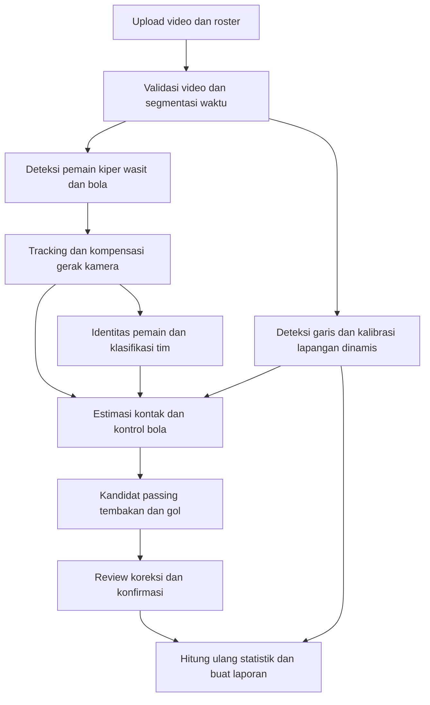

# Rencana Futsal Video Analytics

Tanggal: 31 Oktober 2026. Status: rancangan awal; belum implementasi atau benchmark.

## 1. Tujuan dan keputusan awal

Membangun aplikasi untuk mengubah video futsal menjadi statistik tim dan pemain, dengan bukti video untuk setiap kejadian dan fasilitas koreksi.

Konteks yang sudah dikonfirmasi:

- Input dari satu kamera yang bergerak atau mengikuti bola.
- Video diunggah dan dianalisis setelah pertandingan; belum memerlukan live analytics.
- Fokus kebutuhan: pemain, passing, gol, dan pengembangan statistik pertandingan lainnya.

Rekomendasi: mulai dengan analisis berbantuan AI. Sistem menghasilkan deteksi, kandidat kejadian, dan statistik sementara. Pengguna meninjau identitas serta kejadian yang meragukan sebelum laporan difinalisasi.

Batas utama: rekaman satu kamera tidak menyediakan pengamatan lengkap terhadap pemain dan kejadian di luar frame. Sistem harus menyatakan unknown dan cakupan pengamatan, bukan mengisi bagian yang hilang dengan tebakan.

## 2. Produk yang digunakan analis atau pelatih

Alur penggunaan:

1. Buat pertandingan; masukkan tim, daftar pemain, nomor punggung jika ada, babak, dan ukuran lapangan jika diketahui.
2. Unggah video dan tandai bagian permainan, jeda, babak, potongan yang hilang, serta replay jika ada.
3. Proses video di background; tampilkan progres dan simpan hasil per tahap agar pekerjaan bisa dilanjutkan setelah gagal.
4. Tampilkan video dengan kotak pemain, identitas, tim, bola, serta timeline kandidat passing, tembakan, dan gol.
5. Hubungkan potongan track ke pemain sebenarnya; koreksi kejadian, tambahkan yang terlewat, dan konfirmasi yang benar.
6. Lihat statistik tim/pemain, jaringan passing, dan cuplikan bukti. Heatmap hanya ditampilkan jika kalibrasi lapangan memadai.
7. Finalisasi lalu ekspor CSV, JSON, dan laporan; ekspor spreadsheet/PDF dapat ditambahkan setelah alur inti stabil.

Layar awal yang dibutuhkan: daftar pertandingan, upload/pengaturan pertandingan, progres proses, review video + timeline + identitas, dan laporan.

## 3. Cakupan statistik dan urutan pengembangan

| Statistik | Rilis awal | Pengembangan berikutnya dan syarat |
| --- | --- | --- |
| Pemain, kiper, tim, dan lintasan dalam gambar | Deteksi + tracking; identitas dikoreksi analis | Penyambungan identitas lintas kemunculan, OCR nomor bila terbaca |
| Gol tim dan pencetak gol | Kandidat gol + konfirmasi; identitas pencetak gol boleh unknown | Otomatisasi pada sudut dan kualitas video yang sudah tervalidasi; own goal dicatat terpisah |
| Passing sukses/gagal dan penerima | Kandidat passing + review | Jaringan passing, arah, progresivitas jika posisi lapangan valid |
| Tembakan dan hasilnya | Kandidat shot; label on target/off target/blocked/goal direview | Tren shooting, lokasi tembakan jika kalibrasi valid |
| Assist | Label manual dengan cuplikan dan aturan yang disepakati | Usulan dari rangkaian passing dan gol |
| Penguasaan bola | Estimasi pada interval permainan yang bisa dinilai | Distribusi durasi per tim/pemain dengan unknown dan bola bebas terpisah |
| Interception, turnover, recovery | Label manual atau kandidat sederhana | Otomatisasi setelah passing dan possession cukup stabil |
| Save kiper dan block | Review manual berbantuan kandidat tembakan | Model kejadian khusus dengan data kiper/block |
| Sentuhan dan dribel sukses | Belum dijanjikan otomatis | Memerlukan definisi dan bukti kontak/duel yang cukup jelas |
| Heatmap dan lokasi aksi | Opsional setelah uji kalibrasi kamera bergerak | Posisi pada lapangan; selalu sertakan cakupan pengamatan |
| Jarak dan kecepatan | Ditunda dari statistik utama MVP | Hanya segmen terlihat, terkalibrasi, kontinu; bukan total pertandingan |
| Menit bermain dan pergantian pemain | Log masuk/keluar manual | Kandidat substitusi; keluar frame tidak dianggap otomatis keluar lapangan |
| Pelanggaran, kartu, kick-in, corner, penalti | Pencatatan manual | Kandidat kejadian bila data dan sudut kamera mendukung |
| xG, pressing, rating pemain, formasi | Di luar MVP | Memerlukan definisi, cakupan posisi, data futsal, dan validasi terpisah |

Tidak menjanjikan semua statistik otomatis pada rilis pertama. Perbaikan prioritas adalah mengurangi waktu kerja analis sambil menjaga data dapat diperiksa.

## 4. Arsitektur pemrosesan

Kalibrasi membantu koordinat dan statistik spasial. Jika kalibrasi gagal, review video serta pencatatan kejadian tetap berjalan, sedangkan keluaran spasial dinonaktifkan pada segmen tersebut.

### A. Ingest dan waktu

- Gunakan FFmpeg untuk membaca metadata, membuat proxy video, dan memotong cuplikan bukti.
- Pertahankan presentation timestamp video asli; video variable frame rate tidak dihitung hanya dengan frame_index / FPS.
- Bedakan waktu video, babak, dan jam pertandingan. Waktu efektif memerlukan anotasi atau sumber jam yang tervalidasi.
- Pisahkan potongan kamera, replay, dan jeda; cegah satu gol dihitung ulang dari replay.

### B. Deteksi dan tracking

- Baseline detector: model YOLO pretrained; uji pemain dan bola secara terpisah. Fine-tuning terutama diprioritaskan untuk bola kecil, blur, serta kondisi indoor pada rekaman pengguna.
- Baseline tracker: BoT-SORT dengan kompensasi gerak kamera; bandingkan terhadap ByteTrack sebagai pembanding sederhana. Aktifkan dan evaluasi ReID jika membantu penyambungan identitas.
- Referensi dokumentasi mendukung BoT-SORT dengan kompensasi gerak kamera dan ReID opsional. Ini kandidat awal, bukan jaminan performa pada futsal. [Ultralytics tracking](https://docs.ultralytics.com/modes/track)
- Track ID adalah identitas lintasan sementara, bukan otomatis identitas pemain sepanjang pertandingan. Simpan tracklet dan pemetaan berbatas waktu ke player ID.
- Gunakan petunjuk warna jersey, penampilan, nomor yang terbaca, dan review roster. Kiper/wasit/official perlu dipisahkan agar tidak masuk statistik pemain yang salah.
- Pemain yang keluar frame lalu muncul lagi boleh tetap unknown sampai cukup bukti untuk disambungkan. Nomor punggung membantu jika tersedia, tetapi tidak wajib untuk baseline dengan pemetaan manual.

### C. Kamera bergerak dan posisi lapangan

- Kompensasi gerak kamera untuk tracking tidak sama dengan kalibrasi ke meter di lapangan.
- Gunakan dimensi dan template garis futsal yang sesuai lapangan sebenarnya. Garis olahraga lain pada gedung harus dibedakan.
- Mulai dari titik/garis acuan yang ditandai manual pada keyframe, lalu propagasi dan validasi di antaranya. Perbarui saat pan, zoom, atau perubahan sudut; hentikan propagasi ketika kualitas turun atau terjadi cut.
- Kalibrasi otomatis garis/keypoint dapat dikembangkan setelah baseline manual terbukti. Homography tunggal untuk seluruh video tidak memadai bagi kamera bergerak.
- Proyeksikan titik kontak kaki dengan lantai untuk posisi pemain, bukan pusat bounding box.
- Sertakan error kalibrasi dan cakupan posisi valid. Jangan hitung kecepatan dari lompatan koordinat akibat kamera atau perpindahan ID.
- Homography lantai tidak dapat menentukan lintasan 3D bola yang melayang. Tahan statistik jarak/kecepatan bola dan keputusan geometris yang memerlukan kedalaman.
- SoccerNet memisahkan tracking, identitas, dan kalibrasi dalam rekonstruksi keadaan permainan; konsepnya relevan, tetapi model/template sepak bola tidak diasumsikan langsung cocok untuk futsal. [SoccerNet GSR](https://github.com/SoccerNet/sn-gamestate), [camera calibration](https://www.soccer-net.org/tasks/camera-calibration)

### D. Kontrol bola dan kejadian

- Gunakan riwayat beberapa frame: kedekatan bola ke kaki, gerak relatif, perubahan arah, dan bukti kontak. Pemain terdekat saja tidak cukup.
- State minimal: controlled oleh player ID, bola bebas/in transit, out of play, serta unknown.
- Baseline kejadian memakai aturan temporal yang transparan. Evaluasi model temporal/pose tambahan jika aturan gagal pada one-touch pass, duel, atau shot; jangan menambah kompleksitas sebelum mengetahui pola kegagalannya.
- Contoh passing sukses: ada aksi pelepasan dari A, kemudian bola diterima/dikontrol B satu tim, tanpa kontrol lawan atau restart di antaranya. Defleksi, bola hilang, dan penerima tak terlihat masuk review/unknown sesuai aturan.
- Passing gagal hanya dicatat jika aksi passing dan hasil gagal cukup jelas; bola hilang dari kamera bukan bukti passing gagal.
- Kandidat gol dinilai dari rangkaian shot/bola/gawang dan konteks sesudahnya. Bola di dekat gawang atau masuk kotak deteksi gawang tidak membuktikan bola melewati garis.
- Gol tetap dapat dimasukkan manual saat kamera melewatkan kejadian. Pencetak gol/assist tidak ditebak jika bukti tidak cukup.
- Deteksi aksi adalah pekerjaan tersendiri dari deteksi objek; SoccerNet menyediakan task dan label aksi terpisah sebagai referensi pendekatan, bukan label futsal siap pakai. [Ball action spotting](https://github.com/SoccerNet/sn-spotting)

## 5. Definisi angka agar laporan tidak menyesatkan

- Pass completion = passing sukses / passing dengan hasil yang sudah dipastikan. Tampilkan juga jumlah attempt yang hasilnya unresolved; jangan memasukkannya sebagai gagal atau menyembunyikannya.
- Possession yang ditampilkan harus menyebut denominator: durasi permainan yang teramati dan bisa diklasifikasikan. Laporkan durasi unknown, bola bebas, dan jeda secara terpisah.
- Time on screen tidak sama dengan menit bermain. Menit bermain memerlukan log pergantian dan definisi jam yang dipakai.
- Heatmap menunjukkan posisi yang teramati pada segmen terkalibrasi. Untuk kamera mengikuti bola, hasilnya bias ke area yang direkam; bukan distribusi posisi lengkap pemain.
- Jarak teramati hanya dijumlahkan dalam segmen koordinat valid dan kontinu. Jangan menghubungkan celah offscreen dengan garis lurus lalu menyebutnya total jarak lari.
- Own goal, penalti dalam pertandingan, adu penalti, set piece, assist, dan shot on target memiliki definisi proyek yang dibakukan sebelum pelabelan. Jangan menghitung offside sebagai statistik futsal.
- Setiap angka menyatakan status sementara/final, sumber AI/manual, bukti video, dan cakupan yang relevan. Skor confidence model belum boleh dianggap probabilitas benar sebelum dikalibrasi.

## 6. Stack awal yang direkomendasikan

| Bagian | Pilihan awal | Alasan |
| --- | --- | --- |
| Computer vision | Python, PyTorch, OpenCV, YOLO, BoT-SORT | Ekosistem pelatihan, video, dan tracking |
| Backend | FastAPI | Endpoint pertandingan, upload, job, review, statistik |
| Background process | Worker Python; Redis + RQ saat perlu antrean terpisah | Job lama tidak dijalankan dalam request web |
| Frontend | Next.js/React + TypeScript | Video review, timeline, tabel, visualisasi |
| Database | PostgreSQL | Relasi pertandingan, identitas, kejadian, koreksi |
| Penyimpanan | Disk lokal untuk prototipe; object storage kompatibel S3 saat deploy | Video asli, proxy, model output, cuplikan |
| Data track padat | Parquet per pertandingan/job | Menghindari jutaan baris per-frame dalam tabel transaksi utama |
| Pelabelan | CVAT atau alat sejenis | Bounding box, identitas, garis lapangan, timestamp aksi |

Versi library/model dipilih dan dikunci setelah pilot. Periksa lisensi kode, bobot, serta dataset sebelum menjadikan produk komersial.

GPU lokal atau worker GPU cloud dipilih setelah perangkat pengguna dan hasil benchmark diketahui. Jangan menentukan biaya atau lama proses per pertandingan tanpa mengukur rekaman nyata.

Entitas data inti: Match, Period, Video, Team, Player, MatchRoster, Tracklet, IdentityAssignment, CalibrationSegment, BallState, Event, ReviewRevision, ProcessingJob, StatsSnapshot.

Event menyimpan jenis, rentang/timestamp video, waktu pertandingan jika tersedia, tim, pelaku/penerima opsional, outcome, confidence, status review, sumber, serta tautan bukti. Simpan versi model/pipeline dan definisi metrik. Koreksi disimpan sebagai revisi agar pemrosesan ulang tidak menimpa keputusan analis.

## 7. Dataset dan pembuktian kualitas

Mulai dengan beberapa cuplikan total 10–15 menit yang mencakup pan, zoom, pemain bertumpuk, pergantian, bola blur, area gawang, dan kondisi cahaya. Tambahkan satu pertandingan penuh untuk uji alur end-to-end setelah pilot layak.

Label awal: pemain/kiper/wasit, bola terlihat, identitas yang diketahui, tim, landmark lapangan, passing, shot, gol, interval kontrol bola, dan alasan tidak dapat dinilai.

Tambahkan data berdasarkan kegagalan nyata. Jangan menetapkan jumlah label yang seolah menjamin akurasi sebelum uji.

Pisahkan train/validation/test berdasarkan pertandingan atau sesi rekaman; jangan membagi frame berdekatan dari video yang sama ke train dan test. Uji tambahan pada kamera atau lapangan berbeda untuk menilai generalisasi.

Metrik yang dilaporkan:

- Deteksi: precision/recall pemain dan bola; ball recall dinilai pada frame ketika bola benar-benar terlihat.
- Tracking: IDF1/HOTA, jumlah ID switch, serta ketepatan penyambungan pemain setelah masuk frame lagi.
- Identitas: ketepatan player ID dan proporsi durasi yang berhasil diberi identitas, bukan hanya ketepatan pada subset mudah.
- Kalibrasi: error posisi/reprojection dan persentase durasi dengan kalibrasi valid.
- Event: precision/recall/F1 per jenis pada timestamp bertoleransi yang ditetapkan; passing juga harus benar pengirim, penerima, dan hasilnya.
- Kelengkapan: event teramati, tak teramati, unresolved, dan perbandingan terhadap seluruh event berlabel pada rekaman. Unknown tidak dianggap otomatis benar.
- Produk: selisih statistik terhadap anotasi manual, waktu proses per jam video, biaya komputasi per pertandingan, dan menit review manusia per jam video.

Target pilot sementara, untuk disepakati setelah melihat video: precision dan recall kandidat passing minimal 85% pada aksi yang dapat diamati, dengan evaluasi identitas dan outcome terpisah. Seluruh event berlabel tetap dilaporkan dalam evaluasi end-to-end. Ini target eksperimen, bukan klaim hasil.

Untuk laporan final, seluruh gol dan konflik identitas yang memengaruhi statistik harus direview. Cocokkan skor dengan catatan pertandingan jika tersedia; kelengkapan skor dari review tidak menjadi bukti bahwa deteksi gol otomatis sempurna.

Gate keputusan: jika kualitas bola/identitas tidak memadai, MVP tetap diarahkan ke alat anotasi video berbantuan deteksi; otomatisasi statistik tidak dipaksakan. Jika kalibrasi dinamis tidak memadai, tunda heatmap dan metrik fisik sambil mempertahankan analisis kejadian.

## 8. Roadmap dan hasil setiap tahap

Perkiraan kasar untuk satu engineer berpengalaman dengan dukungan pelabelan/review: sekitar 10–16 minggu untuk MVP berbantuan AI. Tahap dapat tumpang tindih; kebutuhan fine-tuning dan kualitas footage dapat memperpanjangnya. Otomatisasi luas seluruh statistik belum memiliki estimasi yang dapat dipertanggungjawabkan sebelum pilot.

| Tahap | Perkiraan | Hasil dan syarat lanjut |
| --- | --- | --- |
| 0. Audit rekaman dan definisi statistik | 3–5 hari kerja | Laporan kelayakan, sampel berlabel, aturan passing/gol/waktu, benchmark awal |
| 1. Deteksi, tracking, dan identitas dasar | 2–3 minggu | Video overlay, tracklet, klasifikasi tim, pengukuran kegagalan bola/ID |
| 2. Produk review dan pencatatan manual | 2–3 minggu | Upload, job, roster, penyambungan identitas, tambah/koreksi kejadian, ekspor awal |
| 3. Kandidat passing, shot, dan gol | 3–4 minggu | Event engine, antrean review, statistik dihitung ulang dari hasil terkonfirmasi |
| 4. Kalibrasi dan keluaran spasial opsional | 2–3 minggu | Uji pan/zoom, cakupan posisi valid, heatmap jika gate kualitas lolos |
| 5. Evaluasi pertandingan penuh dan stabilisasi | 1–2 minggu | Laporan pembandingan manual, job resume, konsistensi hasil, biaya dan waktu review |

Prioritas jika waktu terbatas: deteksi/tracking → review identitas/kejadian → passing/gol → dashboard. Kalibrasi otomatis, jarak/kecepatan, dan analitik lanjutan tidak menghambat rilis alat review yang berguna.

MVP selesai ketika pengguna dapat memproses satu pertandingan penuh, meninjau serta melengkapi identitas/kejadian, menghasilkan statistik konsisten dengan event terkonfirmasi, menelusuri angka ke cuplikan bukti, dan melihat bagian yang belum teramati atau belum terselesaikan. Target kualitas otomatis ditetapkan dari hasil pilot dan diuji pada rekaman terpisah.

## 9. Langkah awal berikutnya

Implementasi pertama adalah proof of concept pada cuplikan representatif: overlay pemain/bola, tracking, pengelompokan tim, dan laporan masalah identitas serta kualitas bola. Sertakan uji kalibrasi dinamis kecil untuk memutuskan apakah heatmap layak masuk MVP.

Input yang dibutuhkan ketika implementasi dimulai: cuplikan asli beserta resolusi/FPS, daftar pemain bila ada, ukuran lapangan jika diketahui, contoh aturan statistik yang diinginkan, serta informasi perangkat/GPU. Ini kebutuhan tahap berikutnya; penyusunan rencana tidak bergantung pada tersedianya input tersebut sekarang.
